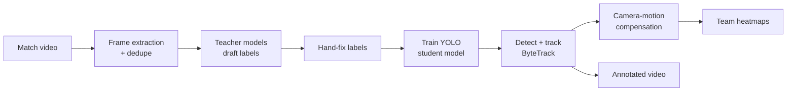

# Brawl Stars VOD Analyzer

Computer vision that watches a Brawl Stars match and tracks where every brawler goes.

The official Brawl Stars API only gives you match results. This project reads the match itself: it detects and tracks every brawler on screen, tells allies from enemies, and turns their movement into per-team heatmaps.

<!-- Demo GIF goes here once Phase 4 is done -->
<!--  -->

## What it does

Input: a gameplay video (screen recording or a match clip).

Output:
1. **An annotated video.** Every brawler is boxed, colored by team (blue = ally, red = enemy), and given a tracking ID that stays the same across frames.
2. **Team heatmaps.** Where each team spent time on the map, corrected for the moving camera.

## How it works



**1. Auto-labeling with teachers.** Labeling hundreds of frames by hand is slow, so two "teacher" methods draft the boxes:
- **Health-bar heuristic (classic CV):** every brawler has a colored health bar above it. HSV color masks find the bars, and each bar gives both a box and a team.
- **YOLO-World (open vocabulary):** detects characters from a text prompt with no training; team comes from the nearest health-bar color.

Both are scored against 50 hand-labeled "gold" frames, and the better one labels the rest. I fix its mistakes, then train a small, fast **student** YOLO model on the cleaned data. The student ends up more accurate than either teacher because it only has to learn this one game.

**2. Detection and tracking.** The student model finds brawlers in each frame. ByteTrack links those detections across frames into consistent IDs, even when a brawler is briefly hidden.

**3. Camera-motion compensation.** The camera follows the player, so a brawler standing still still moves across the screen. Phase correlation (`cv2.phaseCorrelate`) estimates how far the background shifted between frames. Adding up those shifts gives the camera offset, which converts screen positions into map positions:

$$
p_{\text{world}} = p_{\text{screen}} + \sum_{s=1}^{t} \left(\Delta x_s, \Delta y_s\right)
$$

**4. Heatmaps.** The feet position (bottom-center of each box) of every brawler is binned into a 2D histogram per team, smoothed, and overlaid on the map.

## Results

| Metric | Value |
|---|---|
| Labeled frames | TBD |
| Best teacher (precision / recall on gold set) | TBD |
| Student mAP50 (validation videos) | TBD |
| Ally/enemy mix-up rate | TBD |

<!-- Add figures/confusion_matrix.png, figures/heatmap_ally.png, figures/heatmap_enemy.png -->

Train and validation sets are split **by match**, not by frame, since frames from the same match are near-duplicates and would inflate the scores.

## Project structure

```text
brawl-stars-vod-analyzer/
├── src/brawl_vod/
│   ├── frames.py        # frame extraction + near-duplicate removal
│   ├── teachers.py      # health-bar heuristic + YOLO-World
│   ├── labels.py        # YOLO label conversion, IoU
│   ├── track.py         # detection + ByteTrack, annotated video
│   ├── camera.py        # phase-correlation camera offsets
│   └── heatmap.py       # world positions -> team heatmaps
├── scripts/             # extract_frames, auto_label, compare_teachers, train, analyze_match
├── configs/data.yaml    # YOLO dataset config
├── models/              # trained weights
├── figures/             # plots, heatmaps, demo GIF
├── tests/
└── data/                # not committed: raw video, frames, labels
```

## Setup

Requires Python 3.12.

```bash
git clone https://github.com/AydanEddieGonzalez/brawl-stars-vod-analyzer.git
cd brawl-stars-vod-analyzer
python -m venv .venv
.venv\Scripts\activate        # Windows (macOS/Linux: source .venv/bin/activate)
pip install -r requirements.txt
pytest
```

## Usage

```bash
python scripts/analyze_match.py path/to/match.mp4 --out outputs/
```

Writes `outputs/annotated.mp4`, `outputs/heatmap_ally.png`, and `outputs/heatmap_enemy.png`.

## Roadmap

- [ ] Phase 0: Repo setup + record training matches
- [ ] Phase 1: Frame extraction and dedupe
- [ ] Phase 2: Teacher models, gold set, teacher comparison, label cleanup
- [ ] Phase 3: Train the student YOLO model
- [ ] Phase 4: Tracking + annotated video
- [ ] Phase 5: Camera-motion compensation + heatmaps
- [ ] Phase 6: Demo on a pro match clip, final README

**Ideas for v2:** mid-control %, fight detection, distance traveled per player, detecting supers/gadgets/ball/gems, a small web demo.

## Limitations

- Trained on one mode and map first, so other maps may need more data.
- Brawlers hidden in bushes aren't visible, so they aren't tracked.
- Pro broadcast footage uses different camera angles and overlays than regular gameplay, so results there may be weaker.

## What I learned

<!-- Fill in as you go -->

## Disclaimer

This is a fan project and is not affiliated with, endorsed, sponsored, or approved by Supercell. Brawl Stars and its assets are trademarks of Supercell. Gameplay footage used for training is not redistributed in this repo.

Built with [Ultralytics YOLO](https://github.com/ultralytics/ultralytics) (AGPL-3.0), so this project is released under AGPL-3.0 as well.
